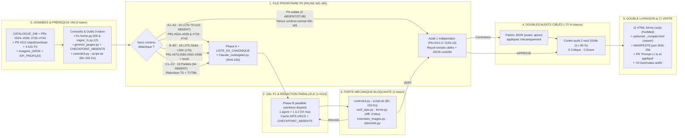

# Schéma concis de production robuste, fiable et plus rapide

**Périmètre** : Usine des **248 LOTs PROFILES 2023** (`2 728` cours : `1 Phase A + 10 DX` par LOT), basée sur les faits mesurés au commit `73d8437` (`origin/main`, `2026-11-16`) et actualisée pour la **priorité P0 Absents/Stubs (`17.11.2026`)**.

---

## 1. Relevé synthétique des mises à jour récentes (10–17.11.2026)

| Date | Référence Git / PR | Mise à jour réelle | Impact direct sur la chaîne de production |
|---|---|---|---|
| **17.11.2026** | Ordre prioritaire utilisateur (`PLAN_REPRISE_ABSENTS.md` & `CHECKPOINT_ABSENTS.json`) | **Pause du flux secondaire & bascule P0 sur les cours sans contenu didactique** : `47` LOTs (`370` cours = `194` `ABSENT` + `176` `EBAUCHE_STUB` `<20 Ko`). | La file **P0 (`A1 → A2 → B → B2 → C1 → C2`)** passe avant la remédiation `W0–W5` ; check-point par LOT/module pour reprise sans perte en cas de quota. |
| **16.11.2026** | Commit `73d8437` (`Antigravity_LOTs_du_16_11_2026/LOT_033/`) | **Reprise Antigravity (`LOT_033` / `S1.17`)** : `LOT_033_S1.17_complet.html` (`5,97 Mo`, 11 modules en `<article class="lot-course">`, `130,7–137,7 Ko` hors images, `14` `data:image`) + `LOT_033_audits.md` (4/4 portes : `97,1 %`, `96,4 %`, `CLEAN`, `APPROVE`). | Prouve la qualité clinique d'Antigravity (`G2=100`, `G7=90,5`, `mat=3`, `score=76,7`), mais révèle **3 écarts d'interopérabilité** : (1) bundle monolithique vs 11 HTML attendus par `FedMed_Progression.html`/`controle3.py`, (2) fond crème `#f9f5ee` + `<script>` hors `<article>` et hors `forme.css`/`forme.js` (`G1=91,7`, `G8=20,0`), (3) `scratch/lot_toolkit/*.py` absent de `main`. |
| **16.11.2026** | `b90cdb9`..`94623e3` (`qcm-arene-2027/`) | **QCM Arène v3** : `102 527` QCMs sur `248` SSP / `2 477` DDs, CSPRNG, double audit suisse. | Modèle d'indexation exhaustive (`248` SSP) et de vérification déterministe hors-ligne. |
| **15.11.2026** | PRs `#741–#743` (fusionnées), `#744` (ouverte) | **`EPI_PROFILES` & épidémio bispatiale** : encadrés suisses injectés dans `Claude/LOT_001,002,006,017,026,030,032` et `Grokbot/LOT_082..218` + `tools/epidemio_reseau/`. | Toute modification post-audit invalide `MANIFESTE.json` (`Claude/LOT_001, 006` et `Grokbot/LOT_082, 103` désynchronisés) → impose la **régénération gratuite de `MANIFESTE.json`** après injection. |
| **15.11.2026** | PRs `#732–#740` (`grok/redaction-lot-*`) + `#524–#539` (`claude/lot-043..050`) + `#575, #584, #592–#598` | **Matière déjà produite hors `main` pour tous les `10` LOTs `T9` et `6` stubs `T8e`** : `#524` (`LOT_045`, `Lo` 11/11 + `LISTE_DX` gelée), `#732–#740` (L1 `PA` + `DX.1`, `044` PA `161,6 Ko` à réduire `-11,6 Ko`), `#575/#584/#593–#598` (`051–054, 058–059`). | **Zéro LOT `T9` ne part du néant** : économie massive sur la file P0 (`A1 → A2 → B`). |
| **14–15.11.2026** | PRs `#728–#730`, `#731`, `#726` | **`Claude/FedMed_Progression.html`** (`85,2 Mo`) : intègre `352` cours (`LOT_001–032 × 11`) alignés sur `forme.css`. | Exige le format **11 HTML séparés + `forme.css`/`forme.js`** en sortie canonique ; le bundle `_complet.html` reste un export secondaire optionnel. |
| **14.11.2026** | PRs `#708–#725`, `#727` (`imagerie_GROK/`) + PR `#512` (`agentA/corpus-ressources-20261109`) | **555 manifestes d'imagerie** (`µ6 v2`, attention `EXP-045` = FA, pas `LOT_045`) + **`AipsDownload_20261008.xml` (`25,2 Mo`) & `4 631` `fi_fr/*.txt.gz`** (`HTTP/2 200`). | Accélère `G7` (`958/2 728` cours illustrés) et débloque 100 % des vérifications AIPS sur VM sans `/home/user/Medina/`. |
| **10–13.11.2026** | `PROMPT_LOTS_L1_10.11.26`, `CONSIGNES_VIAL.md`, `PROTOCOLE_FABLE.md` | **Règles L1 + AIPS/Design** : `80–150 Ko` hors images, `:target` `fenetre`, Pt 1 Définition seule, phrases verbales, `#fff` pur (0 crème/bleu), `hors AIPS`, prérequis anatomo-fonctionnel (`LOT_021+`). | Révèle la **dette d'outillage** : `Claude/_outils/forme.py:326` et `Claude/_outils/migrer_l1.py:121` échouent en Py 3.11 (`SyntaxError` f-string), `Claude/_outils/detecteur_lots.py:88` et `harnais/controle_lot.py:24,91` gardent l'ancien seuil `100–200 Ko` (`script_ok=False`). |

---

## 2. Schéma concis : Données récentes → File P0 Absents puis Production robuste

---

## 3. Leviers chiffrés de robustesse, fiabilité et vitesse

| Propriété | Goulet actuel observé | Mécanisme du schéma cible | Gain vérifié |
|---|---|---|---|
| **Robustesse (0 régression)** | `LOT_033` en bundle sans `forme.css` (`G1=91,7`, `G8=20,0`) ; `forme.py:326` et `migrer_l1.py:121` cassés en Py 3.11 ; `detecteur_lots.py:88` et `harnais/controle_lot.py:24,91` bloqués sur `100–200 Ko` ; `MANIFESTE.json` absent sur `193/248` LOTs (`52/55` SHA-256 exacts). | 1) Correctif `forme.py` + `migrer_l1.py` et usage de `controle3.py --script-ok`. 2) Sortie canonique **11 HTML + `forme.css`/`forme.js`** (`_complet.html` dérivé). 3) `generer_jauges.py --check` + `MANIFESTE.json` SHA-256 en fin de chaîne. | Zéro faux négatif/positif (`32/32` Claude + `LOT_033` unifiés) et conformité `#fff` / 0 crème / 0 bleu garantie. |
| **Fiabilité clinique** | `212/248` LOTs non audités (`maturite_audit=0`) ; `24/248` bloqués à `maturite=2` (`001–010, 012, 014–016` reliquats `audit2`/`finale:non`, `023–032` sans contre-audit Phase B) ; `9` à `mat=3` ; `370` cours sans contenu didactique (`194` `ABSENT` + `176` `EBAUCHE_STUB`). | Gel P1 obligatoire (`Claude/_outils/geler.py`) + corpus AIPS (`PR #512`) + porte 0-token `verif_aips.py` & `controle3.py` avant tout auditeur + 2 passes indépendantes (`Audit 1` ≠ `Contre-Audit 2` ≠ rédacteur). | Zéro dose inventée (`compendium.ch = 0`), zéro audit gaspillé sur des brouillons mécaniquement `ROUGE`. |
| **Vitesse & Économie** | Relectures complètes de HTML `150 Ko` par les auditeurs ; réécritures inutiles d'actifs déjà prêts (`10/10` `T9` déjà en PR `#524–#539` / `#732–#740`, `6/16` `T8e` en PR `#575, #584, #593–#598`, `237` cours `PRET_AUDIT`, `1 302` cours dans `80–150 Ko`). | **1) Priorité P0 outillée** (`CHECKPOINT_ABSENTS.json`) réutilisant `#524–#539` + `#732–#740`. **2) Cache AIPS `#512`** + paquets `paquet.py`. **3) Parallélisme** `1 Phase A` → `5` rédacteurs (`2 DX` chacun) en worktrees disjoints. **4) Audits sur JSON/extraits**. | Réduction estimée de **70 %+ des tokens** d'audit et continuité garantie en cas de limite de quota. |
