# Schéma concis de production robuste, fiable et plus rapide

**Périmètre** : Usine des **248 LOTs PROFILES 2023** (`2 728` cours : `1 Phase A + 10 DX` par LOT), basée sur les faits mesurés au commit `73d8437` (`origin/main`, `2026-11-16`).

---

## 1. Relevé synthétique des mises à jour récentes (10–16.11.2026)

| Date | Référence Git / PR | Mise à jour réelle | Impact direct sur la chaîne de production |
|---|---|---|---|
| **16.11.2026** | Commit `73d8437` (`Antigravity_LOTs_du_16_11_2026/LOT_033/`) | **Reprise Antigravity (`LOT_033` / `S1.17`)** : `LOT_033_S1.17_complet.html` (`5,97 Mo`, 11 modules en `<article class="lot-course">`, `130,7–137,7 Ko` hors images, `14` `data:image`) + `LOT_033_audits.md` (4/4 portes : `97,1 %`, `96,4 %`, `CLEAN`, `APPROVE`). | Prouve la qualité clinique d'Antigravity (`G1=100`, `G2=100`, `G7=90,5`), mais révèle **3 écarts d'interopérabilité** : (1) bundle monolithique vs 11 HTML attendus par `FedMed_Progression.html`/`controle3.py`, (2) fond crème `#f9f5ee` + `<script>` inline hors `forme.css`/`forme.js` (`G8=20,0`), (3) `scratch/lot_toolkit/*.py` absent de `main`. |
| **16.11.2026** | `b90cdb9`..`94623e3` (`qcm-arene-2027/`) | **QCM Arène v3** : `102 527` QCMs sur `248` SSP / `2 477` DDs, CSPRNG, double audit suisse. | Modèle d'indexation exhaustive (`248` SSP) et de vérification déterministe hors-ligne. |
| **15.11.2026** | PRs `#741–#743` (fusionnées), `#744` (ouverte) | **`EPI_PROFILES` & épidémio bispatiale** : encadrés suisses injectés dans `Claude/LOT_001,002,006,017,026,030,032` et `Grokbot/LOT_082..218` + `tools/epidemio_reseau/`. | Toute modification post-audit invalide `MANIFESTE.json` (ex. `LOT_006` : `mat=3`, `MANIFESTE` désynchronisé) → impose la **régénération gratuite de `MANIFESTE.json`** après injection. |
| **15.11.2026** | PRs brouillons `#732–#740` (`grok/redaction-lot-*`) | **9 LOTs `T9` déjà en cours** hors `main` : `043(#737), 044(#733), 046(#740), 047(#734), 048(#739), 049(#738), 050(#736), 080(#735), 102(#732)` (`25` HTML). | Évite de réécrire de zéro `9` des `10` LOTs manquants ; seul `LOT_045` (`S2.6`) est totalement orphelin. |
| **14–15.11.2026** | PRs `#728–#730`, `#731`, `#726` | **`Claude/FedMed_Progression.html`** (`85,2 Mo`) : intègre `352` cours (`LOT_001–032 × 11`) alignés sur `forme.css`. | Exige le format **11 HTML séparés + `forme.css`/`forme.js`** en sortie canonique ; le bundle `_complet.html` reste un export secondaire optionnel. |
| **14.11.2026** | PRs `#708–#725`, `#727` (`imagerie_GROK/`) | **555 manifestes d'imagerie** audités (`µ6 v2`). | Accélère `G7` (`958/2 728` cours déjà dotés d'images) par réutilisation directe d'actifs licenciés libres. |
| **10–13.11.2026** | `PROMPT_LOTS_L1_10.11.26`, `CONSIGNES_VIAL.md`, `PROTOCOLE_FABLE.md` | **Règles L1 + AIPS/Design** : `80–150 Ko` hors images, `:target` `fenetre`, Pt 1 Définition seule, phrases verbales, `#fff` pur (0 crème/bleu), `hors AIPS`, prérequis anatomo-fonctionnel (`LOT_021+`). | Révèle la **dette d'outillage** : `forme.py:326` échoue en Python 3.11 (`SyntaxError` backslash f-string), `detecteur_lots.py:88` et `harnais/controle_lot.py:24` mesurent encore l'ancien seuil `100–200 Ko` (`script_ok=False`), `progression.py` est aveugle aux 8 axes. |

---

## 2. Schéma concis : Données récentes → Production robuste, fiable et rapide

```mermaid
flowchart LR
    subgraph S0["0. DONNÉES & CORRECTIFS GRATUITS (0 token)"]
        D1["CATALOGUE_248 + ATTRIBUTIONS\n+ PRs #732–740 + imagerie_GROK\n+ EPI_PROFILES (#741–744)"]
        D2["Générateur & Pré-portes 0-token\n• Fix forme.py:326 (Py 3.11)\n• detecteur_lots.py L1 (80–150 Ko)\n• generer_jauges.py (G1–G8)"]
        D1 --> D2
    end

    subgraph S1["1. TRIAGE ÉCONOMIQUE"]
        T{"Score & État\nsur disque"}
        T -->|"Déjà L1/VERT\n(ex. 023–033)"| A1_IN
        T -->|"Partiel / T3–T8\n(patch ciblé)"| P1
        T -->|"Stub <20K / T9\n(rédaction neuve)"| P1
    end

    D2 --> T

    subgraph S2["2. GEL P1 & RÉDACTION PARALLÈLE (1+5/10)"]
        P1["Phase A + LISTE_DX_CANONIQUE\n+ geler.py (verrou SHA-256)"]
        PB["Phase B parallèle (worktree disjoint)\n1 agent = 1 à 2 DX max\nCache paquets/AIPS partagé"]
        P1 --> PB
    end

    subgraph S3["3. PORTE MÉCANIQUE BLOQUANTE (0 token)"]
        G0["controle3.py --script-ok (80–150 Ko)\nverif_aips.py · forme.py (#fff, 0 bleu)\ninventaire_images.py · planche5.py"]
        PB --> G0
        G0 -->|"ROUGE"| PB
    end

    subgraph S4["4. DOUBLES AUDITS CIBLÉS (-70 % tokens)"]
        A1_IN["Audit 1 indépendant (A+DX1-5 / DX6-10)\nReçoit extraits ciblés + JSON contrôle"]
        FIX["Patchs JSON {avant, apres}\nappliqués mécaniquement"]
        A2["Contre-audit 2 neuf (Grille Q ≥ 90 %)\n0 Critique · 0 Grave"]
        G0 -->|"VERT"| A1_IN
        A1_IN -->|"Corrections"| FIX --> A2
        A1_IN -->|"APPROVE"| A2
    end

    subgraph S5["5. DOUBLE LIVRAISON & CI VERTE"]
        OUT["11 HTML forme.css/js (FedMed)\n+ optionnel _complet.html (viewer)\n+ MANIFESTE.json SHA-256\n+ PR 'Prompt L1 lu et appliqué'"]
        A2 --> OUT
    end
```

---

## 3. Leviers chiffrés de robustesse, fiabilité et vitesse

| Propriété | Goulet actuel observé | Mécanisme du schéma cible | Gain vérifié |
|---|---|---|---|
| **Robustesse (0 régression)** | `LOT_033` en bundle sans `forme.css` ; `forme.py:326` cassé en Py 3.11 ; `detecteur_lots.py` bloqué sur `100–200 Ko` ; `MANIFESTE.json` absent sur `246/248` LOTs. | 1) Correctif `forme.py` + alignement L1 de `detecteur_lots.py`. 2) Sortie canonique **11 HTML + `forme.css`/`forme.js`** (`_complet.html` dérivé). 3) `generer_jauges.py --check` + `MANIFESTE.json` SHA-256 en fin de chaîne. | Suppression des faux positifs/négatifs (`32/32` Claude + `LOT_033` unifiés) et conformité `#fff` / 0 crème / 0 bleu garantie. |
| **Fiabilité clinique** | `212/248` LOTs non audités (`maturite_audit=0`) ; `20/248` bloqués à `maturite=2` (`001..016` reliquats, `023..032` sans contre-audit Phase B) ; `176` stubs `<20 Ko`. | Gel P1 obligatoire avant Phase B (`LISTE_DX.audit.json == GEL`) + porte 0-token `verif_aips.py` + `controle3.py` avant tout appel d'auditeur + 2 passes indépendantes (`Audit 1` ≠ `Contre-Audit 2` ≠ rédacteur). | Zéro dose inventée (`compendium.ch = 0`), zéro audit gaspillé sur des brouillons mécaniquement `ROUGE`. |
| **Vitesse & Économie** | Relectures complètes de HTML `150 Ko` par les auditeurs ; réécritures inutiles de cours déjà exploitables (`39` Grokbot `T8b` déjà dans `80–150 Ko` ; `9` LOTs `T9` déjà en PR `#732–#740`). | **1) Pré-triage gratuit** (`generer_jauges.py`) routant vers *audit direct*, *patch ciblé*, ou *rédaction*. **2) Cache SHA-256** AIPS/paquets. **3) Parallélisme** `1 Phase A` → `5` rédacteurs (`2 DX` chacun) en worktrees disjoints. **4) Audits sur JSON/extraits** (jamais le HTML brut complet). | Réduction estimée de **70 %+ des tokens** d'audit et réutilisation des `9` PRs `#732–#740` + `1 302` cours déjà dans la bande `80–150 Ko`. |
