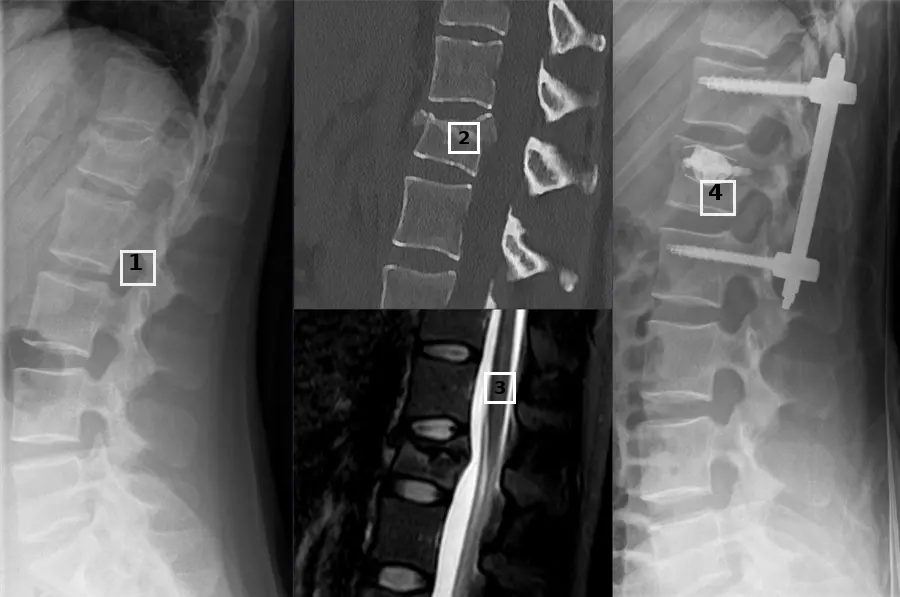

# Réponse aux audits 1 à 8 — LOT_114

## Correction 8 — option A (image relue)

Le carré 2 était sur le corps intact sous la fracture. Il est maintenant sur le bord droit, côté canal, du corps cunéiforme du scanner. Le carré 3 est dans le sac clair de l’IRM, à l’étage fracturé de ce panneau seulement. Les deux panneaux restent distincts : aucune phrase ne dit que l’os du repère 2 rejoint le sac du repère 3.

Carré par carré, capture du 15 novembre 2026 :

1. Radiographie de profil, panneau de gauche : carré 1 sur un corps vertébral, avant la fixation.
2. Scanner sagittal, panneau du milieu en haut : carré 2 sur le bord postérieur du corps cunéiforme fragmenté, côté canal, et non plus sur le corps intact du dessous.
3. IRM, panneau du milieu en bas : carré 3 dans la colonne claire du sac, à la hauteur de la vertèbre fracturée de ce cliché.
4. Contrôle après vissage, panneau de droite : carré 4 sur le montage, hors du diagnostic initial.

## Audit 7 (00cbcab4, 77/100)

| Défaut | Correction | Où |
|---|---|---|
| G1. Repères 2 et 3 hors du conflit. | Carré 2 déplacé sur le mur postérieur du corps fracturé qui recule. Carré 3 déplacé dans le sac dural clair, au même étage. Image relue. | `images/burst-annotee.webp` |
| m2. Point 13 à sept phrases. | La fusion des deux phrases de corticoïdes dépasse 28 mots. Phrase redondante retirée : l’ordre E1-E2-E3 est déjà dans la démarche et dans l’arbre. Six phrases restent. | Point 13 |
| m3. E5, E6, E7 dans le tableau et l’arbre. | Remplacés par « même bande E, sans ordre ». | Points 4 et 10 |
| m4. Cause fausse de l’heure du traumatisme. | « On date l’heure du traumatisme pour suivre l’évolution du déficit au cours du temps. » La cause proposée par l’audit n’est pas reprise : aucune source lue ne la dit. | Point 5 |
| m5. Pas d’organisme suisse de prévention. | Aucun texte inventé. La limite reste dans HELP. | HELP |
| m6. Rotation décrite par la douleur. | « Si le patient ne peut pas tourner activement la tête à 45 degrés de chaque côté… », fiche HAS de novembre 2020. | Point 8 |

## Audit 6 (9fc6e173, 80/100)

| Défaut | Correction | Où |
|---|---|---|
| G1. « Après la phase aiguë » n’est pas dans Schizas. | Retiré au point 4 et dans la liste. « L’isthme de C2 (axis) ne reste pas dans les dix, et il est opéré si les clichés dynamiques montrent une instabilité. » La parenthèse « axis » reste : première occurrence du sigle. | Point 4, `LISTE_DX_CANONIQUE.md` |
| m2. « Séquelles » décale la définition. | « résultant d’un traumatisme », phrase de l’audit. | Point 1 |
| m3. E5, E6 et E7 comme létalité. | Liste : « même bande E, sans ordre de létalité lu ». Les trois drapeaux restent. | Liste |
| m4. Étiquette Scholz. | « Gaudin G et al., stratégies des burst incomplets A3, Brain and Spine, 12 décembre 2025 ». URL gardée. | Bibliographie |
| m5. Point 13 à sept phrases. | Les deux phrases de corticoïdes sont réunies dans la phrase de l’audit. Elle compte 40 mots avec le développement de NASCIS, 34 sans lui. La porte s’arrête à 32 : verdict ORANGE, texte non raccourci. | Point 13 |
| m6. Cellules sous 12 mots. | Allongées sans fait nouveau. Phrases AIPS non touchées. | Tableau du point 4 |
| m7. Pas d’organisme suisse de prévention. | Aucun texte BPA ni OFSP inventé. Le point reste partiel. | HELP |
| m8. Méta-commentaires. | « la conduite retenue » ; « hors AIPS, et aucune dose de corticoïde n’est écrite », avec le développement déjà exigé du sigle. | Points 8 et 11 |
| m9. E5 avant E4. | Le nœud E4 suit E3, puis les nœuds cervicaux. | Point 10 |
| m10. Deux heures avant le geste. | « En chirurgie générale à risque modéré, la première injection de 20 mg… » | Fenêtre Clexane |

## Audit 5 (f8c5deba, 73/100)

| Défaut | Correction | Où |
|---|---|---|
| G1. Le point 1 n’est pas une définition. | Phrase retirée. Définition lue : EUROSPINE, dictionnaire approuvé le 1 juillet 2020, « fracture / trauma : Fracture or discoligamentous injury as sequelae of trauma. » Traduction fidèle, ancre `eurospine-2020`, lecture du 15 novembre 2026. NICE NG41 ne définit pas (usually involves) : non retenue. | Point 1, HELP |
| G2. « Seule » une lésion C3-C5. | « une lésion à ce niveau ou au-dessus peut supprimer la ventilation. » Les parenthèses « racine cervicale » restent, car la porte des sigles exige le développement à la première occurrence. | Point 3 |
| G3. Repère 1 trop bas. | Carré 1 déplacé sur la moelle cervicale haute, sous la base du crâne, au-dessus de la base du cou. Phrase conservée. Image relue. | `images/moelle-annotee.webp` |
| G4. IRM rendue obligatoire. | Phrase de Schizas : rôle discuté, hernie chez près de la moitié, faible risque. | Point 9 |
| m5. « Après la phase aiguë ». | Retiré de la phrase opératoire de l’isthme. | Point 8 |
| m6. Tear-drop et burst cervical absents de l’arbre. | Nœud ajouté. Point 13 : drapeau sans rang de létalité lu. | Points 10 et 13 |
| m7. Pronostic devenu critère de sortie. | Phrase de mauvais pronostic moteur, revue de 2005. | Point 11.D |
| m8. Deux phrases sur l’absence de taux. | Première supprimée, seconde gardée. | Point 4 |
| m9. Corticoïdes sans le consensus 2024. | Phrase 2024 séparée : la phrase unique de l’audit compte 34 mots, au-delà des 32 de la porte. NASCIS développé. | Point 13 |
| m10. Cellules courtes. | Mur postérieur continu ; rétrécissement du canal. | Tableau du point 4 |

La phrase du point 4 qui dit encore « après la phase aiguë » pour expliquer l’absence de l’isthme dans les dix n’était pas dans la correction demandée. Elle reste.

Base corrigée : `21c904bcd`. Rapport 3 : `d7049c02`, fichier `audits/AUDIT_PHASE_A_3.md`. Liste non gelée.

| Défaut | Correction | Où |
|---|---|---|
| A3-1 Grave. Point 1 = « la source décrit », pas une définition. L’audit 3 demandait de laisser le point vide. | Le brief de correction 3 et le refus d’un point 1 vide imposent une définition en « est ». Trois phrases, 23, 21 et 18 mots, termes présents dans les passages cités : fracture, lésion ligamentaire pure, lésion neurologique, rachis cervical ou thoraco-lombaire (RMS 2005) ; fracture sans neurologie et lésion médullaire complète ou incomplète (RMS 2005) ; disque, ligament, statut neurologique intact (AOSpine 2017). Aucun « décrit », aucune épidémiologie, aucun type A/B/C. | Point 1 |
| A3-2 Grave. Tableau : burst cervical E5, tear-drop E6, facette E5 (E5 en double, E7 absent). | Tableau aligné sur la liste : DX.6 E6, DX.7 E7, DX.8 E5. DX.1, DX.2 et DX.5 sans rang E. E1 à E7 chacun une fois. Script de contrôle : aucune mention de DX.i ne porte un autre E. | Point 4, arbre, points clés |
| A3-3 Grave. Toute luxation classée E3. | « Si la tomodensitométrie montre un déplacement rotatoire thoraco-lombaire, alors classer E3… » puis « Si la facette cervicale est luxée, alors classer E5 et la réduire avec prudence. » | Point 10 |
| A3-4 Grave. DX.1 présenté comme plus fréquent que DX.2. | Compression et burst écrits ex æquo dans le type A (63,3 %). Les numéros ne disent pas qu’une fracture est plus fréquente. E1 reste la lésion médullaire par la ventilation, pas par la fréquence. | Point 4, liste |
| A3-5 Grave. « Revue genevoise » pour Schizas (Lausanne). | « revue lausannoise de 2005 ». | Point 8 |
| A3-6 Grave. Diaphragme attribué à toute la moelle cervicale, sans source. | « Le nerf phrénique reste celui de C3 à C5, donc seule une lésion cervicale haute peut supprimer la ventilation. » Source Meister, RMS, 13 août 2014. | Point 3 |
| A3-7 Grave. Repère 2 sur le corps sus-jacent. | Carré 2 déplacé sur le corps tassé au milieu du scanner, même étage que le sac du repère 3. Image relue. « Le repère 2 reste sur le corps dont le mur postérieur recule, et le repère 3 reste sur le sac dural au même étage. » Le verbe « reste » remplace « siège », que la porte nominale refuse. | `images/burst-annotee.webp`, point 9 |
| A3-8 Grave. Quatre phrases de lacune ou de méta-commentaire. | Supprimées. Conduite artérielle seule : « Si le foramen de l’artère vertébrale est touché, alors demander une angio-IRM. » Lacunes versées dans HELP.md. | Points 2, 4, 5, HELP |
| A3-9 Grave. Finale « oui » alors que la revue nomme trois lésions hors des dix. | « La réponse reste non », avec la lésion ligamentaire pure, le ligament transverse de C1 et l’isthme instable de C2. | Point 14 |
| A3-10 Grave. Heure du traumatisme calée sur les huit heures de corticoïdes. | « On date l’heure du traumatisme pour suivre le déficit, car la Revue médicale suisse de 2014 ne recommande plus les corticoïdes à haute dose. » Aucun milligramme ajouté. | Point 5 |
| A3-11 Mineur. « Au-delà de 76 ans ». | « À 76 ans ou plus », aux deux occurrences. | Points 2 et 12 |
| A3-12 Mineur. Voie postérieure étendue à tort vers 50–66 %. | « La voie postérieure est décrite jusqu’à 33 % de rétrécissement, et l’abord antérieur au-delà de 66 %, sans étendre la voie postérieure à la bande intermédiaire. » | Point 9 |
| A3-13 Mineur. Cellules nominales. | « L’écart postérieur se palpe et se voit sur la coupe. » « La distraction ouvre la bande de tension. » « La coupe axiale mesure le canal. » Les autres lignes du tableau comparatif ont un verbe. | Point 4 |
| A3-14 Mineur. NEXUS et règle canadienne trois fois. | Le détail des cinq absences et des critères canadiens reste au point 8. La fenêtre et l’arbre ne gardent que la décision d’imager ou non. | Points 8, 9, 10 |
| A3-15 Mineur. Bénéfice modeste de 2005 non situé face à 2024. | Phrase de 2005 conservée, puis : « Le consensus européen de 2024 recommande d’envisager la décompression dans les 24 heures, après les détresses vitales. » | Point 11 |
| A3-16 Mineur. Prévention sans organisme suisse daté. | « La cohorte suisse SwiSCI, publiée en 2015, indique les chutes des personnes âgées et les accidents des hommes jeunes comme cibles. » Pas de texte BPA ni OFSP inventé. | Point 12 |
| A1 critiques et graves tenus (ne pas rouvrir). | Morphine : traumatisme crânien et hypertension, zéro dose, sans exception. Clexane : huit femmes, 1 mg/kg deux fois par jour, décès de la mère et du fœtus. Grossesse du paracétamol recopiée. Dafalgan = mot de la fiche Stada. Morphine du nouveau-né seulement sur l’ancre 53571. Clexane : 20 mg, 40 mg, trois semaines en plus, rhumatologie, alcool benzylique, nouveau-né, détresse du prématuré, pas de dose néonatale. | Points 11 et 14 |
| A1–A2 tenus. | 63,3 % = tout le type A. Flexion-distraction E4 avec le nœud d’écart postérieur. E1 = ventilation ou aggravation, pas le SMR 2,32. 17 % = C1–C8 A/B/C, plus 9,2 % et 7,6 %. Luxation facettaire dans les dix. Gaudin : 41, 33, 26, 12°. Taux américains 150 000 et 40 par million absents. Quatorze points et sept fenêtres lisibles. Rembourrage du point 12 absent. | Tout le fichier |
